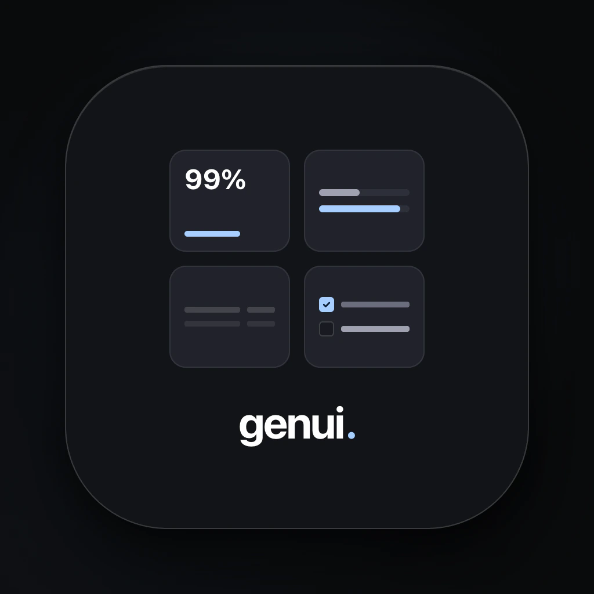
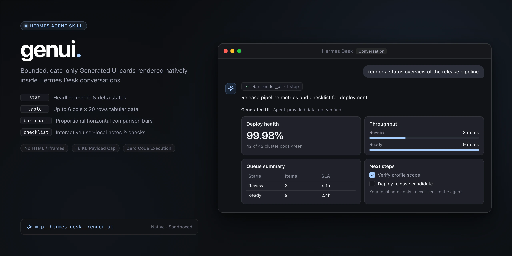
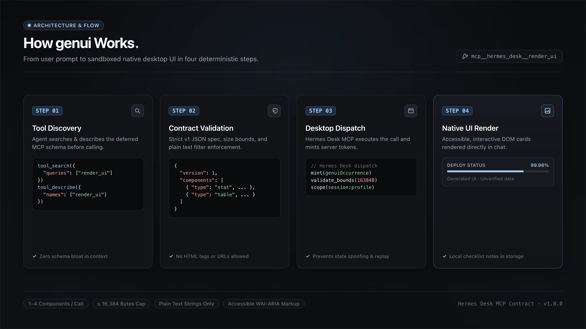
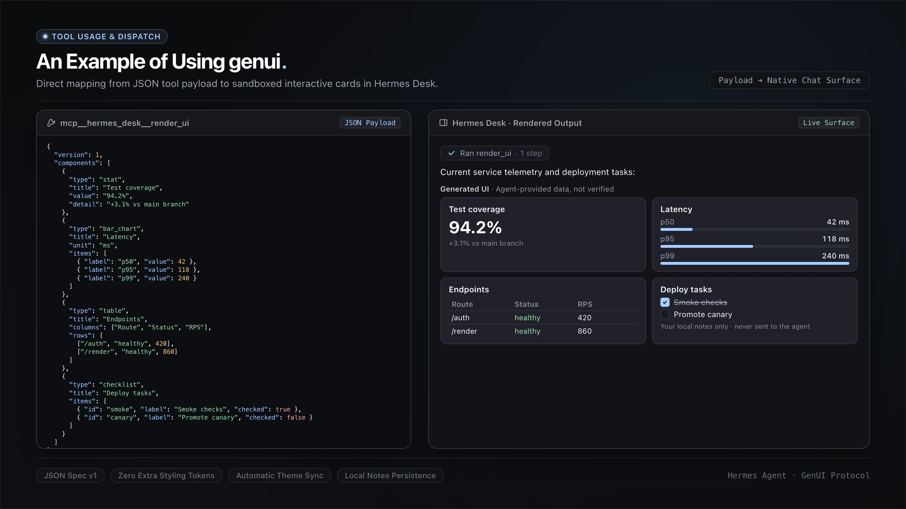
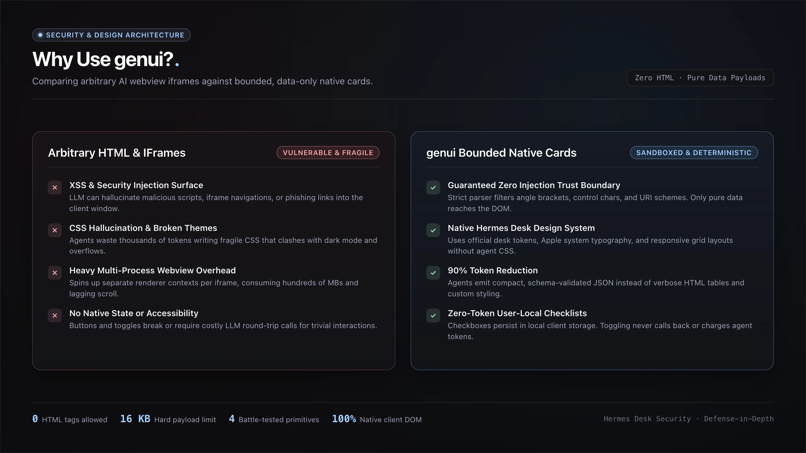

<p align="center">
  <br>
  
</p>

# genui

<p align="center">
  <a href="LICENSE"></a>
  <a href="schema/v1.json"></a>
  <a href="https://github.com/DevvGwardo/genui/commits/main"></a>
</p>

A [Hermes Agent](https://github.com/NousResearch/hermes-agent) skill for rendering bounded, data-only Generated UI cards — stat cards, tables, bar charts, and checklists — natively inside [Hermes Desk](https://github.com/DevvGwardo/hermes-desk) conversations via the `mcp__hermes_desk__render_ui` MCP tool.

No HTML. No `::preview` iframes. Just native, accessible data widgets that render straight into the chat surface.

## Contents

- [What it renders](#what-it-renders)
- [How it works](#how-it-works)
- [Install](#install)
- [Prerequisites](#prerequisites)
- [Usage](#usage)
- [Troubleshooting](#troubleshooting)
- [Example](#example)
- [Why "data-only"?](#why-data-only)
- [License](#license)

## What it renders

| Widget | Use for |
|---|---|
| `stat` | A single headline number with title + optional detail line |
| `table` | Up to 6 columns × 20 rows of mixed string/number cells |
| `bar_chart` | 1–12 labeled bars, optional unit label |
| `checklist` | 1–20 items with unique ids and checked state (user-local notes only) |

Rendered blocks are labeled by Hermes Desk as **Generated UI · Agent-provided data, not verified** — they are presentation, not proof.

## How it works

<p align="center">
  
</p>

From a user prompt to sandboxed native desktop UI, in four steps:

1. **Discovery:** The agent locates the deferred tool using `tool_search` and `tool_describe`, so the schema stays out of the context window by default.
2. **Validation:** Payload is checked against the strict v1 schema, size limits (&le; 16,384 bytes), and string sanitization rules — no HTML tags or URLs allowed.
3. **Dispatch:** Hermes Desk executes the tool and mints a server-side `genuiOccurrence` token, preventing state spoofing.
4. **Rendering:** Native, accessible DOM cards render directly into the conversation stream; checklist state is stored locally as user-local notes.

## Install

The skill folder must land in your Hermes skills directory as a direct child named `genui` — `<skills-dir>/genui/SKILL.md` — matching the skill's own name in its frontmatter. Pick your shell:

### Bash (macOS, Linux, or Git Bash on Windows)

```bash
git clone https://github.com/DevvGwardo/genui.git
mkdir -p ~/.hermes/skills
cp -r genui/skills/genui ~/.hermes/skills/
```

Profile-scoped skills directory instead:

```bash
cp -r genui/skills/genui ~/.hermes/profiles/<your-profile>/skills/
```

### PowerShell (Windows)

```powershell
git clone https://github.com/DevvGwardo/genui.git
New-Item -ItemType Directory -Force "$HOME\.hermes\skills" | Out-Null
Copy-Item -Recurse "genui\skills\genui" "$HOME\.hermes\skills\"
```

Profile-scoped skills directory instead:

```powershell
Copy-Item -Recurse "genui\skills\genui" "$HOME\.hermes\profiles\<your-profile>\skills\"
```

Restart your Hermes session (`+ New chat` in Hermes Desk) so the skill loader picks it up.

### Verify the install

```bash
test -f ~/.hermes/skills/genui/SKILL.md && echo "genui skill installed"
```

```powershell
Test-Path "$HOME\.hermes\skills\genui\SKILL.md"
```

Profile-scoped installs: use `~/.hermes/profiles/<your-profile>/skills/genui/SKILL.md` (or the `$HOME` equivalent in PowerShell) instead of the path above. Then restart the session and ask for a card — for example, *"genui: render a stat card showing the current sprint velocity"*. If a card renders, the install is complete.

### Uninstall

```bash
rm -rf ~/.hermes/skills/genui
```

```powershell
Remove-Item -Recurse -Force "$HOME\.hermes\skills\genui"
```

Profile-scoped installs: `rm -rf ~/.hermes/profiles/<your-profile>/skills/genui` (or the `$HOME` equivalent). Restart the session so the skill unloads.

## Prerequisites

- A Hermes profile with **Settings → Workspace → Agent browsing** enabled (this is what exposes `mcp__hermes_desk__render_ui`).
- Tool search enabled (`tools.tool_search.enabled: auto`) so the deferred MCP schema can be discovered — the skill includes the exact `tool_search` → `tool_describe` → invoke sequence.

## Usage

Once installed, trigger it naturally:

- *"genui"* — the skill's trigger word
- *"render a table of …"*
- *"render a stat card showing …"*
- *"render a checklist for …"*

The skill enforces a strict v1 schema contract, hard caps (1–4 components per call, ≤ 4 calls per turn, ≤ 16,384 bytes), and a string validator that rejects markup, URLs, and control characters — so agents can't smuggle HTML or links into the rendered surface.


## Troubleshooting

| Symptom | Likely cause | Fix |
|---|---|---|
| The call fails with `not_enabled` or `app_unavailable` | Hermes Desk MCP is disabled for the active profile | Enable **Settings → Workspace → Agent browsing** and restart the session (`+ New chat`); the skill's Pitfalls list covers this. |
| The agent can't find `render_ui` at all | The skill folder is not in a path this profile's loader scans | Confirm the files landed: `test -f ~/.hermes/skills/genui/SKILL.md && echo found` — and check that tool search is enabled (`tools.tool_search.enabled: auto`). |
| The call is rejected with `bad_args` | The payload violated a bound or the string filter | Walk SKILL.md's "Pre-flight Self-check" and fix the field it flags. |
| The call is rejected with `too_large` | The serialized payload is over the byte cap | Apply the ordered rules in SKILL.md's "Pruning Under the Byte Cap", then retry. |
| Checkboxes reset, or don't appear on your other device | By design: toggles are user-local notes kept in local storage | No fix needed — they never sync and never call back to the agent. |
| Card text looks unformatted | By design: card fields are plain text only | Put links and formatting in your surrounding message; keep card fields plain. |

## Example

<p align="center">
  
</p>

## Why "data-only"?

<p align="center">
  
</p>

*Design illustration. Measured equivalent: ≈73–78% fewer emitted bytes than equivalent styled HTML artifacts for the same content — see [`docs/context-reduction.md`](docs/context-reduction.md).*

The comparison behind the data-only design — arbitrary HTML/iframe rendering versus bounded, data-only native cards:

| Arbitrary HTML & iframes (vulnerable & fragile) | genui bounded native cards (sandboxed & deterministic) |
|---|---|
| **XSS & injection surface** — the model can hallucinate malicious scripts, iframe navigations, or phishing links into the client window. | **Zero-injection trust boundary** — the strict parser filters angle brackets, control characters, and URI schemes, so only plain data reaches the DOM. |
| **CSS hallucination & broken themes** — agents spend tokens writing fragile CSS that clashes with dark mode and overflows. | **Native Hermes Desk design system** — cards use the desk's own tokens and layouts, with no agent CSS to clash with the theme. |
| **Heavy multi-process webview overhead** — a separate renderer context per iframe, adding significant memory overhead and laggy scrolling. | **Compact by construction** — agents emit compact, schema-validated JSON instead of verbose HTML tables and custom styling; the measured token reduction is ≈73% versus a typically styled equivalent HTML artifact for the same content (≈78% richly styled; UTF-8 bytes — see [`docs/context-reduction.md`](docs/context-reduction.md)). |
| **No native state or accessibility** — buttons and toggles break or need costly model round-trips for trivial interactions. | **Zero-token user-local checklists** — checkbox state persists in local client storage; toggling never calls back to the agent. |

Hermes Desk renders these widgets in a sandboxed native surface, and the skill documents the exact constraints — no angle brackets, no URI schemes, no `genuiOccurrence` spoofing — so any agent using it stays inside the trust boundary.

## License

MIT
