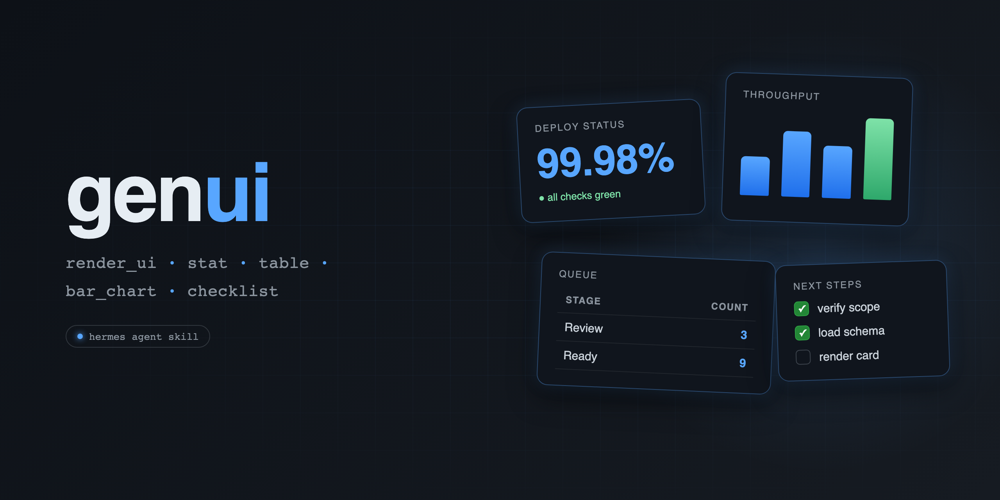
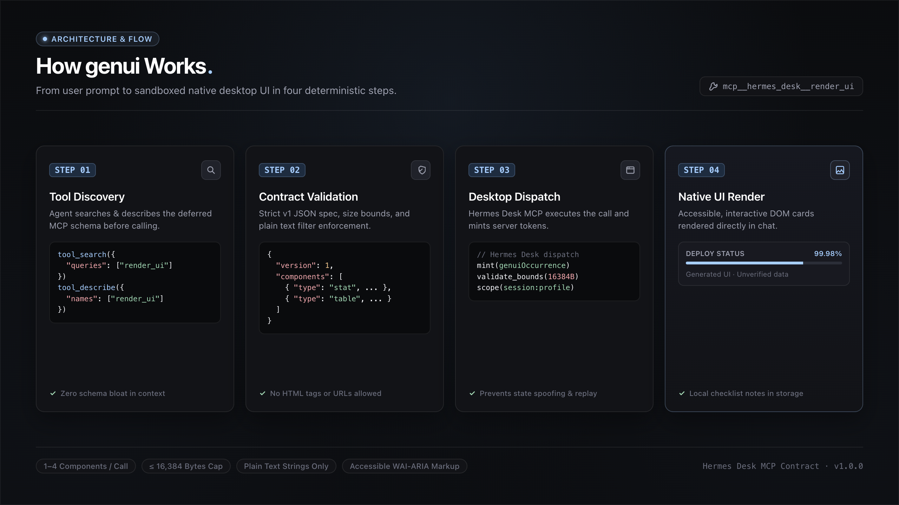
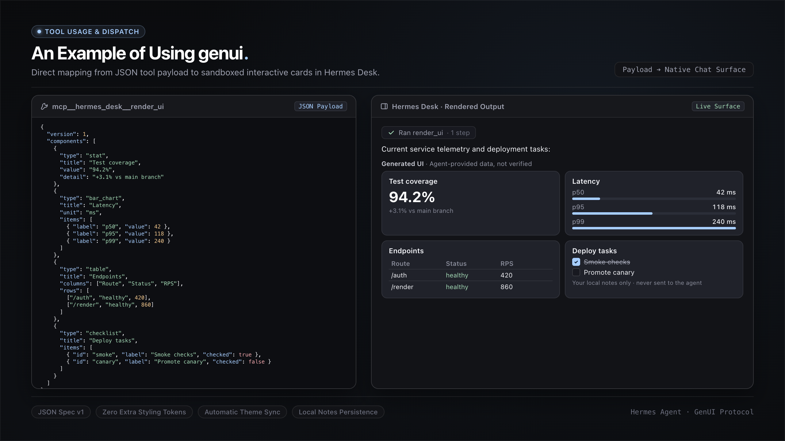
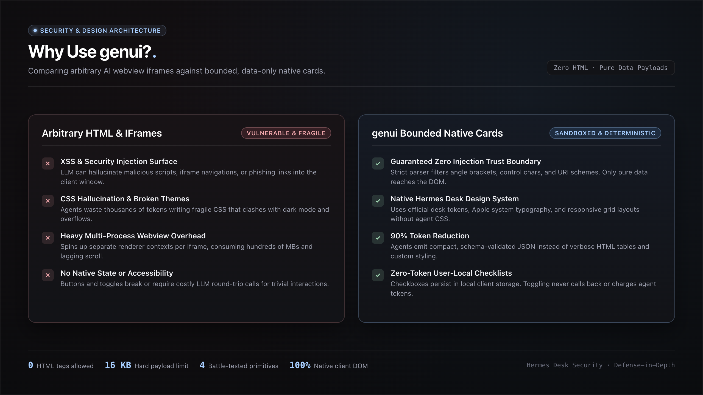

<p align="center">
  
</p>

# genui

A [Hermes Agent](https://github.com/NousResearch/hermes-agent) skill for rendering bounded, data-only Generated UI cards — stat cards, tables, bar charts, and checklists — natively inside Hermes Desk conversations via the `mcp__hermes_desk__render_ui` MCP tool.

No HTML. No `::preview` iframes. Just native, accessible data widgets that render straight into the chat surface.

## What it renders

| Widget | Use for |
|---|---|
| `stat` | A single headline number with title + optional detail line |
| `table` | Up to 6 columns × 20 rows of mixed string/number cells |
| `bar_chart` | 1–12 labeled bars, optional unit label |
| `checklist` | 1–20 items with unique ids and checked state (user-local notes only) |

Rendered blocks are labeled by Hermes Desk as **Generated UI · Agent-provided data, not verified** — they are presentation, not proof.

## How it works

<p align="center">
  
</p>

1. **Discovery:** The agent locates the deferred tool using `tool_search` and `tool_describe`.
2. **Validation:** Payload is checked against the strict v1 schema, size limits (&le; 16 KB), and string sanitization rules.
3. **Dispatch:** Hermes Desk executes the tool and mints a server-side `genuiOccurrence` token.
4. **Rendering:** Native, accessible DOM cards render directly into the conversation stream with user-local checklist state.

## Install

Copy `skills/genui/` into your Hermes skills directory:

```bash
git clone https://github.com/DevvGwardo/genui.git
mkdir -p ~/.hermes/skills/desktop-ui
cp -r genui/skills/genui ~/.hermes/skills/desktop-ui/
```

Or, if you use profile-scoped skills:

```bash
cp -r genui/skills/genui ~/.hermes/profiles/<your-profile>/skills/
```

Restart your Hermes session (`+ New chat` in Hermes Desk) so the skill loader picks it up.

## Prerequisites

- A Hermes Desk profile with **Settings → Workspace → Agent browsing** enabled (this is what exposes `mcp__hermes_desk__render_ui`).
- Tool search enabled (`tools.tool_search.enabled: auto`) so the deferred MCP schema can be discovered — the skill includes the exact `tool_search` → `tool_describe` → invoke sequence.

## Usage

Once installed, trigger it naturally:

- *"genui"* — the skill's trigger word
- *"render a table of …"*
- *"render a stat card showing …"*
- *"render a checklist for …"*

The skill enforces a strict v1 schema contract, hard caps (1–4 components per call, ≤ 4 calls per turn, ≤ 16,384 bytes), and a string validator that rejects markup, URLs, and control characters — so agents can't smuggle HTML or links into the rendered surface.

## Example

<p align="center">
  
</p>

## Why "data-only"?

<p align="center">
  
</p>

Hermes Desk renders these widgets in a sandboxed native surface. The skill documents the exact constraints — no angle brackets, no URI schemes, no `genuiOccurrence` spoofing — so any agent using it stays inside the trust boundary. Checklist toggles are user-only local notes and never call back to the agent.

## License

MIT
